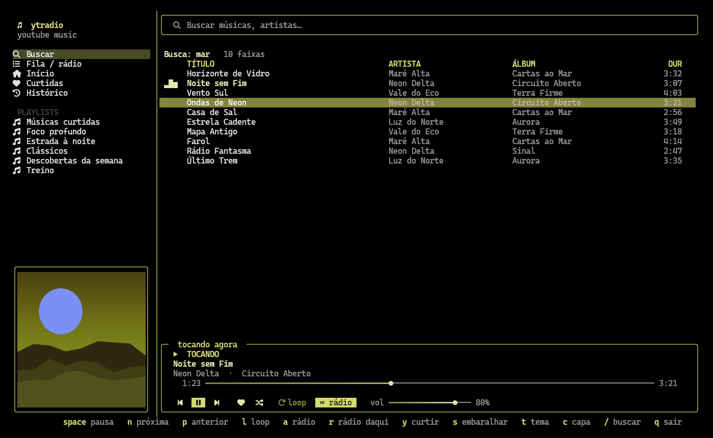
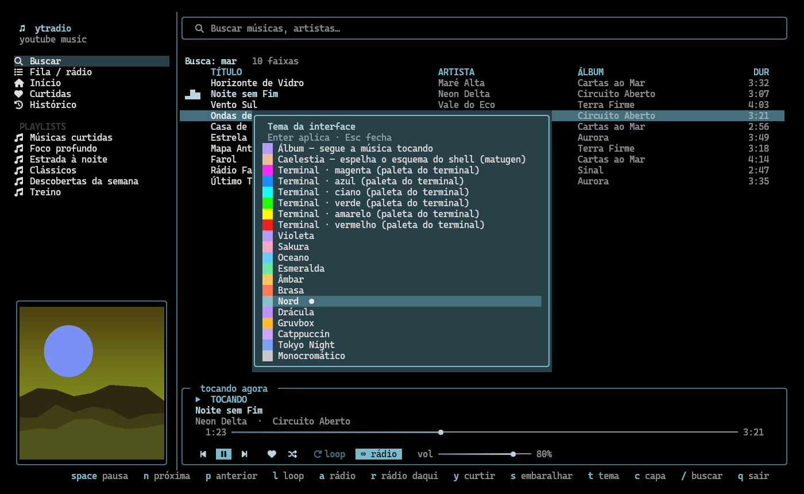

# ytradio

YouTube Music no terminal, com **busca, biblioteca, rádio infinito**, capa do álbum em imagem real, temas e mouse.



Você escolhe uma música, e quando ela termina (ou você aperta `n`) o ytradio busca outra **parecida**, sem parar.
Não gostou? Passa. Quer repetir? `l`. O áudio é **stream** (não baixa nada) e o consumo fica em torno de 150–230 MB.

Desenvolvido e testado no Linux (Fedora/Bazzite + Hyprland + kitty).

## Recursos

- **Rádio infinito**: a fila é reabastecida com músicas parecidas (o "rádio" do YouTube Music) e nunca acaba. `r` inicia um rádio a partir da música selecionada.
- **Tudo do YouTube Music**: busca, início, curtidas, histórico e as suas playlists (com a sua conta).
- **Capa em imagem real** no kitty (verificado) e em terminais com sixel (não testado); em blocos de texto nos demais.
- **Temas**: segue as cores da capa, as cores ANSI do seu terminal (acompanha a paleta do terminal), 12 presets e o esquema do [Caelestia](https://github.com/caelestia-dots/shell)/matugen. Tecla `t`.
- **Mouse completo**: barras de busca e volume arrastáveis, botões clicáveis, ordenar clicando no cabeçalho, arrastar para reordenar a fila, divisória redimensionável, botão direito para iniciar um rádio.
- **Visualizador de espectro** (estilo [cava](https://github.com/karlstav/cava)) nas cores do tema. Tecla `v` liga/desliga. Linux: captura a saída de áudio do sistema via `parec`/`pw-record` (PulseAudio/PipeWire) e usa `numpy`; sem eles, fica desativado.
- **Controles de mídia do sistema**: MPRIS no Linux (teclas de mídia, `playerctl`, widgets do desktop) e SMTC no Windows (experimental).
- Próxima faixa já resolvida em segundo plano: pular é quase instantâneo.



## Requisitos

| | |
|---|---|
| Python | 3.12 ou superior |
| libmpv | para tocar (Fedora: `mpv-libs` · Debian/Ubuntu: `libmpv2` · Arch: `mpv` · Windows: `mpv-2.dll`) |
| node, bun **ou** deno | o `yt-dlp` precisa de um runtime JavaScript para resolver os desafios do YouTube |
| Um navegador **com login** no music.youtube.com | de onde o ytradio lê os cookies (veja [Login](#login)) |
| Terminal com cores reais | kitty, WezTerm, Windows Terminal, GNOME Terminal… |
| Nerd Font (opcional) | para os ícones; sem ela use `YTRADIO_ICONS=plain` |

## Instalação

### Linux / macOS

```bash
git clone https://github.com/Felipe-Alves-VNGX/ytradio
cd ytradio
./install.sh
ytradio
```

O script cria um venv (`.venv`) e o comando `~/.local/bin/ytradio`.

### Windows (experimental)

> O Windows ainda **não foi testado em uma máquina real**: a camada de plataforma é coberta por testes que simulam o Windows no Linux.
> Se algo falhar, abra uma issue com a mensagem de erro.

```powershell
git clone https://github.com/Felipe-Alves-VNGX/ytradio
cd ytradio
powershell -ExecutionPolicy Bypass -File .\install.ps1
.\ytradio.cmd
```

Antes de abrir, coloque o `mpv-2.dll` (ou `libmpv-2.dll`) na pasta do ytradio ou em `%APPDATA%\ytradio\mpv`
([download do libmpv](https://sourceforge.net/projects/mpv-player-windows/files/libmpv/)) e instale um runtime JavaScript (`winget install OpenJS.NodeJS`).
Use o **Windows Terminal**. Sem Nerd Font os ícones simples já são o padrão.

## Login

O ytradio **não pede senha**: ele lê os cookies de login do YouTube diretamente do seu navegador, a cada execução
(os cookies rotacionam, então uma cópia estática duraria poucas horas). Eles ficam na sua máquina e só são enviados ao YouTube.

- **Firefox, Zen, LibreWolf, Waterfox**: entre no music.youtube.com e pronto. O ytradio acha o perfil que tem login (Linux, macOS e Windows).
- **Chrome / Edge / Brave (Linux)**: `YTRADIO_BROWSER=chrome`.
- **Chrome no Windows**: o Chrome 127+ criptografa os cookies de um jeito que o yt-dlp **não consegue ler**.
  Use o Firefox ou o Zen só para o login, **ou** exporte um `cookies.txt` do Chrome (extensão tipo *Get cookies.txt LOCALLY*,
  de preferência de uma janela anônima, para os cookies não serem rotacionados) e aponte com `YTRADIO_COOKIES=C:\caminho\cookies.txt`.

### Configuração (opcional)

Variáveis de ambiente ou o arquivo `config.json` (Linux: `~/.config/ytradio/`, Windows: `%APPDATA%\ytradio\`):

```json
{
  "browser": "firefox",
  "profile": "/caminho/do/perfil",
  "cookies_file": "/caminho/cookies.txt",
  "icons": "plain"
}
```

| Variável | Efeito |
|---|---|
| `YTRADIO_BROWSER` | `firefox` (padrão), `zen`, `chrome`, `edge`, `brave`… |
| `YTRADIO_PROFILE` | pasta do perfil Firefox/Zen (padrão: detecta o que tem login) |
| `YTRADIO_COOKIES` | arquivo `cookies.txt` (Netscape) em vez de ler do navegador |
| `YTRADIO_ICONS` | `plain` para símbolos simples (padrão no Windows) |
| `YTRADIO_MPV_DIR` | pasta do `mpv-2.dll` (Windows) |
| `YTRADIO_SCHEME` | arquivo de esquema do Caelestia/matugen (padrão `~/.local/state/caelestia/scheme.json`) |
| `YTRADIO_SMTC=0` | desliga os controles de mídia do Windows |

## Uso

| Tecla | Ação | | Tecla | Ação |
|---|---|---|---|---|
| `Enter` | tocar / abrir | | `t` | escolher tema |
| `space` | pausa | | `c` | modo da capa (auto/imagem/blocos/sem) |
| `n` / `p` | próxima / anterior | | `/` | buscar |
| `l` | loop da faixa | | `[` `]` | −10 s / +10 s |
| `a` | rádio automático liga/desliga | | `+` `-` | volume |
| `r` | rádio a partir da faixa selecionada | | `y` | curtir |
| `s` | embaralhar a fila | | `v` | visualizador de espectro |
| `q` | sair | | | |

**Mouse**: clique nos botões, chips e atalhos; arraste a barra de progresso e o volume; roda sobre as barras; 1º clique seleciona e 2º toca;
clique no cabeçalho ordena; na **Fila** arraste uma linha para reordenar; arraste a divisória para alargar a barra lateral;
botão direito numa faixa inicia um rádio; clique na capa para pausar.

## Solução de problemas

- **`The page needs to be reloaded`**: o yt-dlp não achou um runtime JavaScript. Instale `node`, `bun` ou `deno`.
  O ytradio procura nos diretórios comuns (inclusive onde apps abertos pelo launcher não herdam o PATH do shell).
- **`Sign in to confirm you're not a bot`**: o login não foi lido. Entre no music.youtube.com no navegador configurado.
- **Ícones quebrados**: instale uma Nerd Font ou use `YTRADIO_ICONS=plain`.
- **`MPRIS indisponível`**: sem barramento D-Bus de sessão; o app funciona normalmente, só sem os controles de mídia do sistema.

## Desenvolvimento

```bash
python tools/mouse_test.py      # 33 verificações de mouse (Textual Pilot, sem rede)
python tools/platform_test.py   # camada multiplataforma (simula o Windows)
python tools/shot.py out.png    # PNG headless (precisa de cairosvg)
tools/preview.sh out.png        # captura num kitty real, em workspace escondida do Hyprland
```

Os testes e as capturas usam dados e capas fictícios (`tools/shot_data.py`).

## Aviso

Projeto pessoal e **não oficial**: não é afiliado ao YouTube nem ao Google. Ele depende do [yt-dlp](https://github.com/yt-dlp/yt-dlp)
e da API interna do YouTube Music via [ytmusicapi](https://github.com/sigma67/ytmusicapi), que podem mudar a qualquer momento.
Use com a sua própria conta e conforme os termos do serviço.

## Licença

[MIT](LICENSE)
